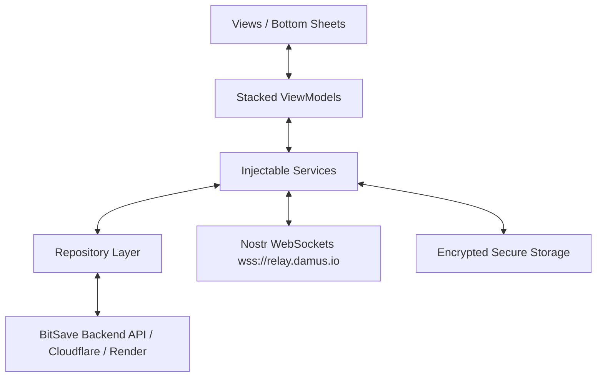

# bitSave ⚡ 

**Mobile-First Bitcoin Savings & Nostr Transfer Application for Emerging Markets**

[](https://flutter.dev)
[](https://dart.dev)
[](https://pub.dev/packages/stacked)
[](https://bitcoin.org)
[](https://nostr.com)
[](test/)
[](LICENSE)

> 🏆 **Hackathon Recognition:** 2nd Place in the Bitcoin-Only Hackathon (*Hack4Freedom*, Organized by Evento).

---

## 📖 Overview

**bitSave** is a non-custodial, mobile-first Bitcoin savings and transfer application engineered for users in emerging markets, starting with Nigeria. High local currency volatility and inflation make long-term financial planning challenging. bitSave bridges traditional fiat finance (Nigerian Naira - NGN) directly into Bitcoin, empowering users to:

1. **Deposit Naira (NGN)** seamlessly using local payment rails (Paystack).
2. **Convert Naira into Bitcoin (Satoshis)** automatically or manually at real-time market rates.
3. **Save Toward Financial Goals** with discipline locks and emergency withdrawal options.
4. **Transfer Bitcoin Across Multiple Protocols** to any Bitcoin on-chain address, Lightning Network invoice/address, or Nostr identity (`npub`).

---

## ✨ Key Features

### ⚡ 1. Nostr & Multi-Protocol Bitcoin Transfers
Send satoshis to anyone using their preferred Bitcoin identifier:
* **Bitcoin On-Chain:** Native support for Legacy (`1...`), P2SH (`3...`), Native SegWit (`bc1q...`), and Taproot (`bc1p...`) addresses.
* **Lightning Network:** Support for Lightning invoices (`lnbc...`) and Lightning addresses (`satoshi@domain.com`).
* **Nostr `npub` Protocol:**
  * Auto-detects Bech32-encoded `npub1...` public keys and decodes them to 32-byte hex public keys.
  * Queries public Nostr relays (`wss://relay.damus.io`, `wss://nos.lol`, `wss://relay.primal.net`) over secure WebSockets.
  * Resolves Kind 0 profile metadata (Display Name, avatar URL, `lud16` Lightning address, and NIP-05 identifier).
  * Signs and broadcasts Kind 9734 zap / transfer events.
  * Automatically records outgoing transfers in the local transaction ledger.
* **Explorer Verification:** Direct deep-link to [mempool.space](https://mempool.space) to verify on-chain transaction status.

### 💰 2. Local Currency (NGN) On-Ramp & Dual Pricing
* **Paystack Integration:** Top up wallet balances with debit cards, USSD, and bank transfers.
* **Live Exchange Rate Engine:** Multi-source Bitcoin pricing engine querying CoinGecko with automated failover to Binance.
* **Dynamic Currency Calculator:** Real-time conversion between Satoshis and Nigerian Naira (NGN).

### 🎯 3. Goal-Based Bitcoin Savings
* Create named targets (e.g., *House Rent*, *Emergency Fund*, *New Laptop*).
* Choose lock periods (30, 90, 180, 365 days).
* Early withdrawal penalty protections to foster long-term savings discipline.

### 🔒 4. Security & Architecture
* **Non-Custodial Design:** User sensitive keys and JWT credentials are encrypted on-device via `flutter_secure_storage` (Keychain on iOS, Android Keystore).
* **Stacked MVVM Pattern:** Strict separation of concerns across Models, Views, ViewModels, and injectable Services.
* **Clean Network Layer:** Dio-powered API client with JWT interceptors, automatic error handling, and configurable staging/production base URLs.

---

## 🏗️ Architecture & Tech Stack



* **Framework:** [Flutter](https://flutter.dev) (v3.x) & [Dart](https://dart.dev) (v3.x)
* **Architecture:** [Stacked](https://pub.dev/packages/stacked) MVVM with `get_it` dependency injection
* **State Management:** Reactive ViewModels (`ReactiveViewModel`, `BaseViewModel`)
* **Networking & HTTP:** `dio` with custom interceptors and retry policies
* **Cryptography & Nostr:** `crypto` (SHA-256), custom Bech32 encoder/decoder, raw WebSocket frames for NIP-01 & NIP-57
* **Pricing & FX:** CoinGecko API + Binance fallback API
* **UI & Theming:** Custom dark-mode theme, Google Fonts (`Red Hat Display`), animated bottom sheets

---

## 📁 Repository Structure

```
bitSave/
├── lib/
│   ├── app/                      # App configuration, router & service locator
│   │   ├── app.dart
│   │   ├── app.locator.dart      # GetIt dependency injection setup
│   │   └── app.router.dart       # Stacked generated routes
│   ├── core/                     # Core business logic, network & models
│   │   ├── config/app_config.dart # Environment switching (dev/staging/prod)
│   │   ├── data/                 # Repositories & API models
│   │   ├── network/              # Dio client, interceptors, API responses
│   │   └── services/             # Secure storage & local persistence
│   ├── models/                   # App models (User, Wallet, Goal, Nostr)
│   ├── services/                 # Domain services
│   │   ├── authentication_service.dart
│   │   ├── bitcoin_price_service.dart   # Live CoinGecko / Binance price feed
│   │   ├── goals_service.dart           # Goal savings management
│   │   ├── nostr_bitcoin_service.dart   # Nostr relays, Bech32 & transfers
│   │   └── wallet_service.dart          # Balances & transaction history
│   └── ui/                       # Presentation layer
│       ├── common/               # App colors, styles, UI helpers
│       ├── components/           # Reusable widgets (cards, buttons, inputs)
│       ├── dialogs/bottom_sheets/
│       │   ├── nostr_transfer_sheet.dart # Bitcoin/Nostr transfer sheet
│       │   └── save_bitcoin_sheet.dart  # Naira-to-BTC savings sheet
│       └── views/                # Full screens
│           ├── auth/             # Login, registration, onboarding
│           ├── dashboard/        # Unified balance card, actions, activity
│           ├── goals/            # Savings goals list & detail
│           └── Profile/          # User profile, wallet & Nostr settings
├── test/                         # Unit & integration test suites
│   ├── bitcoin_price_service_test.dart
│   ├── bitsave_api_test.dart
│   └── nostr_bitcoin_service_test.dart
├── pubspec.yaml                  # Project dependencies & assets
└── README.md
```

---

## 🚀 Getting Started

### Prerequisites
* Flutter SDK (3.24.0 or later)
* Android Studio / Xcode with emulator or connected physical device
* Git

### Installation

1. **Clone the repository:**
   ```bash
   git clone https://github.com/amrahsali/bitSave.git
   cd bitSave
   ```

2. **Install dependencies:**
   ```bash
   flutter pub get
   ```

3. **Generate code (routes & locators if modified):**
   ```bash
   dart run build_runner build --delete-conflicting-outputs
   ```

4. **Run tests to verify setup:**
   ```bash
   flutter test
   ```

5. **Run the app on a connected device or emulator:**
   ```bash
   flutter run
   ```

---

## 🧪 Testing

The codebase includes comprehensive unit tests verifying core financial, pricing, and cryptographic logic:

```bash
flutter test
```

### Test Coverage Highlights
* **Nostr & Address Validation:**
  * Auto-detection of on-chain Bitcoin addresses (Legacy, SegWit, Taproot).
  * Auto-detection of Lightning invoices (`lnbc...`) and Lightning addresses (`name@domain`).
  * Bech32 decoding of `npub1...` to 64-character hex public keys.
  * Validation of invalid / malformed inputs.
* **Exchange Rate Calculations:**
  * Real-time Sats to NGN conversion math with precise floating-point rounding.
  * Price refresh failover handling.
* **API Integration:**
  * Authentication token persistence and header injection.
  * Wallet balance parsing and ledger updates.

---

## 👥 The Team

* **Amrah Uthman Sali** — *Mobile & Frontend Lead Engineer*
* **Karimta Muhammad Hussaini** — *UI/UX Designer*
* **Abubakar Salihu** — *Backend & Infrastructure Developer*

---

## 📄 License

This project is licensed under the **MIT License** — see the [LICENSE](LICENSE) file for details.
